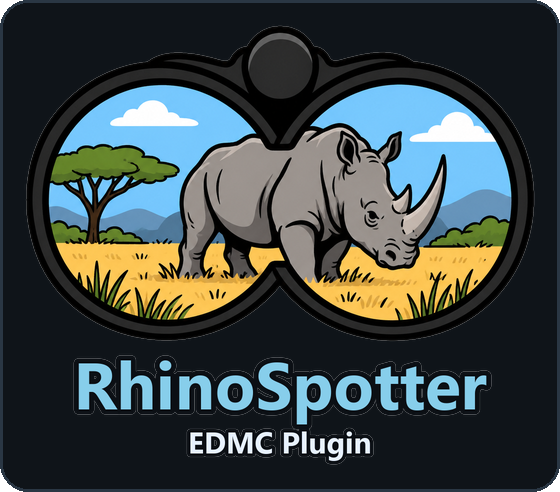

<h1 align="center">
  
</h1>

Surface mining with the Rhino in Elite Dangerous: find the body worth landing
on, bookmark the deposits you find, and drive back to them later.
Runs inside EDMC, or as its own app without EDMC.

| | |
|---|---|
| **RhinoData** | Which bodies in the system are worth landing on, and for which material |
| **Bookmarks** | Save the deposit you are on: material, rigs, amount, density, position |
| **Guide** | An arrow over the game back to any bookmark, from orbit down to the SRV |
| **Minimap** | The ground you have driven in the SRV, with your bookmarks on it |
| **Tons** | Tons mined per bookmark, counted for you |

## Install

Get it from the [latest release](https://github.com/Fumlop/EDRhinoSpotter/releases/latest).
Pick **one** of the two:

**With EDMC** (you already use EDMarketConnector)

1. Download `EDMC_RhinoSpotter-<version>.zip`.
2. In EDMC: **File > Settings > Plugins > Open** - this opens the plugins folder.
3. Unzip into that folder, so you have `plugins\RhinoSpotter\load.py`.
4. Restart EDMC. The RhinoSpotter panel shows up in the EDMC window.

More detail and screenshots: [INSTALL.md](INSTALL.md).
Updates: when a new version is out, the **Bookmark** button reads **Update**. Press it, restart EDMC.

**Without EDMC**

1. Download `Standalone_RhinoSpotter-<version>-Setup.exe` and run it. No admin, no Python needed.
2. Windows may warn "Windows protected your PC": click **More info > Run anyway**.
3. In the app, press **Settings** and pick your Elite journal folder if it is not found.
4. Updates: install the next Setup.exe over it.

Both versions share the same bookmarks. Only one can run at a time; the second one tells you which one is open.

## Your first mining run

1. **Jump into a system and honk** (discovery scan). The bodies load by themselves.
   If the line under the panel asks for an FSS scan, do it.
2. **Press RhinoData** (or **Ctrl+Alt+D**). The left side lists the bodies you can land on,
   grouped by ground type. Pick a material at the top to see where it is found.
3. **Fly to the body, land, deploy the SRV.** The minimap appears and paints where you drive.
4. **Found a deposit?** Put your rigs down, then in the panel set **Material** and **Rigs**
   and press **Bookmark** before you drive off.
5. **Coming back later?** Open RhinoData, pick the bookmark, press **Guide me there**.
   Follow the arrow at the top of the screen.
6. **Mined out?** Press **Mark depleted** on the bookmark.

The arrow over the game only shows in **borderless** or **windowed** mode, not fullscreen.

## The panel

  

1. Land, put the rigs down.
2. Set **Material** and **Rigs**. **Location** fills itself on landing; type over it if it is wrong.
   **Amount** and **Density** from the HUD are optional.
3. Press **Bookmark** before you drive off: the position is taken when you press it.

The same material within 100 m updates the bookmark that is already there instead of adding a new one.

## RhinoData

**RhinoData** button or **Ctrl+Alt+D**.

  

- **Left:** the bodies you can land on, by ground type, with distance and how many bookmarks you have there.
- **Middle:** the body's best materials (how often they are found, median Cr/t), then your bookmarks
  sorted by location: rigs, direction and distance, tons mined, tons left (estimate).
- **Right:** the map around the bookmark and its buttons:
  **Guide me there**, **Share bookmark**, **Mark depleted**, **Copy coords**, **Delete**.
- **Medals** mark the big spots: **bronze** 4 rigs, **silver** 5, **gold** 6-7 rigs in one spot.
  Shown on the body, on the location line and in the Rigs column. Depleted spots get none.
- In the SRV, the bookmark you are standing at (within 175 m) is already picked: Mark depleted is one click.
- A depleted mark goes away by itself after 40 days. From day 14 the card says it may be back (at Low).
- **Systems with bookmarks:** type three letters to jump to another system.

<table align="center">
  <tr>
    <td align="center"></td>
    <td align="center"></td>
    <td align="center"></td>
  </tr>
  <tr>
    <td align="center"><em>Material filter: only grounds that carry it</em></td>
    <td align="center"><em>Mapped tab: saved maps per location</em></td>
    <td align="center"><em>Edit: fix material, rigs, amount, density</em></td>
  </tr>
</table>

**Share a bookmark with a friend:** press **Share bookmark**, paste the line into Discord.
Your friend pastes it into the box under their bookmarks and presses **Import**.
No commander name, dates or tons are in it.

The material numbers tell you where to look, not what a location holds: the game does not say.

## Guide

  

An arrow at the top middle of the game with the distance to the bookmark.
Borderless or windowed mode only.

## Minimap

<table align="center">
  <tr>
    <td align="center"></td>
    <td align="center"></td>
    <td align="center"></td>
  </tr>
  <tr>
    <td align="center"><em>Driving</em></td>
    <td align="center"><em>Center set</em></td>
    <td align="center"><em>Border set, 2x zoom</em></td>
  </tr>
</table>

- Shows up in the SRV while Elite is in front. It paints 2 km (your scanner range) around where you drive; 12 km across, north up.
- Your bookmarks are dots with a material code: green = active, red = depleted.
- In the ship, under 2 km over a saved map: the map, with a dashed 2 km ring where an SRV dropped here would scan.
- At 2x zoom: a solid line to the nearest bookmark of the same material, a dotted one to the next cheaper one.
- Saved per body. Come back within 10 km and it continues the same map.
- "Painted" means you drove within 2 km of it, not that the game confirms a scan.

| Key | Does |
|---|---|
| Ctrl+Alt+Z | Set the location center where you stand |
| Ctrl+Alt+B | Set the border (needs a center first) |
| Ctrl+Alt+M | Zoom 1x / 2x / 4x |
| Ctrl+Alt+D | Open RhinoData |
| Ctrl+Alt+R | Plan rigs: drive the deposit border once, back to where you started |
| Ctrl+Alt+P | Next rig (skip the one the arrow points at) |

You can change the keys in Settings.

**Plan rigs:** in the SRV, press Ctrl+Alt+R and drive once round the purple border.
The lap closes by itself when you are back within 10 m of the start (or press
Ctrl+Alt+R again). Rigs are placed 80 m apart inside it and the arrow points at
rig 1. Put the rig there; the arrow moves on to the next one.

Each time you dock the SRV, a map picture is saved; **Share map** on a location line opens it.
Gold circles mark the best 3 spots where 5+ rigs (4+ if there is no 5) fit within 1.25 km:
one Rhino stop for all of them.

  

## Settings

  

Everything works without touching these.

- Minimap on/off, keep it up when you alt-tab, which corner, or **Free move** (drag it anywhere, any monitor).
- **Golden circle radius:** 500-2500 m in 250 m steps, default 1250.
- **Materials in the lists: Select...** pick which of the 38 materials the dropdowns offer.
  At first: the 18 worth over 50,000 Cr/t, plus any you have a bookmark for.
- **Hotkeys:** modifier + key for each.
- **Upload bookmarks to a team server** (off): only if your team runs one; the admin gives you the
  address and key. [docs/UPLOAD.md](docs/UPLOAD.md).

## Something does not work

| You see | Do this |
|---|---|
| No arrow over the game | Switch Elite to borderless or windowed (Options > Graphics > Display) |
| No bodies in RhinoData | Honk in the system; do the FSS scan if the line under the panel asks for it |
| "Windows protected your PC" on the Setup.exe | **More info > Run anyway** |
| The app says the data is in use | EDMC with the plugin and the standalone app both run: close one |
| Bookmark button reads **Update** | A new version is out: press it, restart EDMC |

## For advanced users

### Data

Everything stays on your PC. Network use: Spansh when you honk (once per system, not again for 30 days,
never for undiscovered systems, paused 1 h after a failed request), GitHub for updates, and the team server
if you turned bookmark upload on.

| What | Where |
|---|---|
| Bookmarks, bodies, maps | `%LOCALAPPDATA%\RhinoSpotter\db\rhinospotter.db` |
| Backups (last 2) | `%LOCALAPPDATA%\RhinoSpotter\db\backups\` |
| Map pictures | `%LOCALAPPDATA%\RhinoSpotter\coverage\<Body>\map N.png` |
| What was uploaded | `%LOCALAPPDATA%\RhinoSpotter\upload_data.json` |
| Material rates | `mining_sheet.json` in the plugin folder |

Your data is outside the plugin folder, so updates do not touch it.

### Linux (beta)

- Data in `$XDG_DATA_HOME/RhinoSpotter` (`~/.local/share`, Flatpak EDMC
  `~/.var/app/io.edcd.EDMarketConnector/data`). An older `~/RhinoSpotter` is copied there once.
- Hotkeys work while Elite has the focus (X11/XWayland). Fallback: type `!rs center`, `!rs border`,
  `!rs zoom` or `!rs data` in chat. It is sent as chat: others on that channel see it.
- The guide arrow sits top middle of the screen; drag it where you want it, right-click puts it back.

### Tools

    python -m rs_core.replay --days 7 --rebuild    # load bodies from older journals - run once after installing

Debug log: `RHINOSPOTTER_DEBUG=1` before starting EDMC. Code layout: [structure.md](structure.md).
Other plugins and tools read bookmarks through `rs_api.py`: [docs/API.md](docs/API.md).

### All features

- **Where to land:** every landable body of the system with the materials its ground carries.
- **Material filter:** only grounds that ever carried it; type a letter in the menu to jump to it. The gear beside it picks which materials the lists offer.
- **Bookmarks:** material, rigs, amount, density and position of the deposit you stand on; a second press on the spot updates it, material too.
- **Medals:** bronze 4, silver 5, gold 6-7 rigs in one spot, on the body, the location and the bookmark.
- **Clusters:** a location's bookmarks grouped by the spot with the most rigs and everything within the golden radius.
- **Golden circles:** the best 3 one-stop groups (5+ rigs, else 4+) circled on the maps, radius set in Settings.
- **Guide:** an arrow over the game back to any bookmark, from orbit down to the SRV.
- **Plan rigs:** drive the deposit border once; rigs planned 80 m apart inside it, the arrow guides to each in turn.
- **Minimap:** the ground you drove in the SRV on the body's ground texture, your bookmarks on it, center, border and drive rings, 3 zoom steps.
- **Map pictures:** saved per body, shareable with a legend and the golden circles.
- **Tons mined:** counted per bookmark from the journal, refreshed 5 s after the last ton.
- **Depleted marks:** set on the card, "may be Low" from day 14, taken off after 40 days.
- **You are here:** the bookmark within 175 m of the SRV marked and picked; locations within 5 km unfolded.
- **Share bookmark:** one line for Discord; paste it into the import box in another RhinoData window.
- **Spansh:** bodies of a new system filled in on the honk.
- **Updates:** from inside EDMC; your data stays outside the plugin folder.

  

